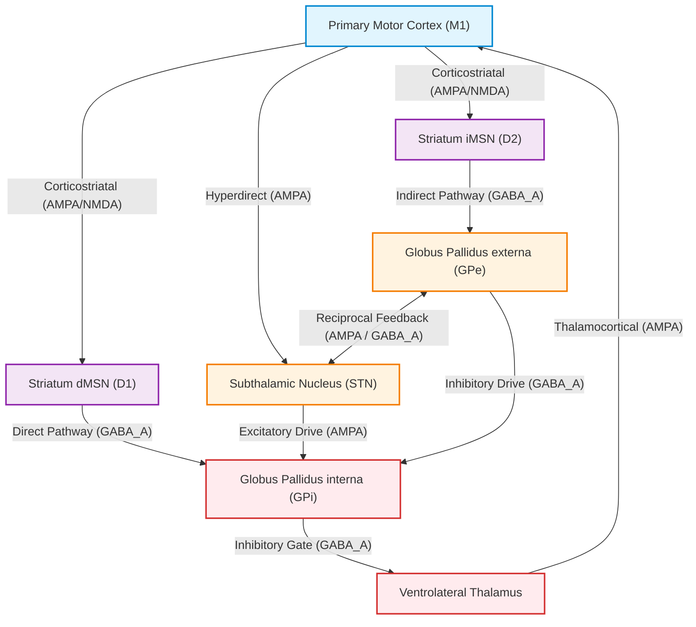
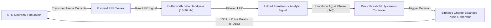

# NeuroSymphony: Computational Neurophysiology & Closed-Loop Deep Brain Stimulation (DBS) Dynamics

[](https://github.com/ZengLLQ/neuro-symphony/actions/workflows/ci.yml)
[](https://www.python.org/)
[](https://opensource.org/licenses/MIT)
[]()
[-crimson.svg)]()

**NeuroSymphony** is an open-source computational neurophysiology and neural engineering platform in Python. It models multi-compartmental biophysical neurons, the complete basal ganglia-thalamocortical (BGTC) looping network, the emergence of pathological 13–30 Hz beta oscillations under dopamine depletion (Parkinson's disease), and real-time adaptive closed-loop deep brain stimulation (aDBS) with phase-resetting control.

---

## Key Capabilities

- **Biophysical Spiking Neurons & Synapses**: Multi-compartmental Hodgkin-Huxley model with active sodium ($I_{\text{Na}}$), delayed rectifier potassium ($I_{\text{K}}$), high-threshold calcium ($I_{\text{Ca}}$), low-threshold T-type calcium ($I_{\text{T}}$), calcium-dependent afterhyperpolarization ($I_{\text{AHP}}$), and dynamic intracellular $[Ca^{2+}]$. Full support for 2D Izhikevich quadratic firing regimes (RS, FS, IB, CH, LTS, TC) and conductance-based AMPA, NMDA (with voltage-dependent $Mg^{2+}$ block), $\text{GABA}_A$, and $\text{GABA}_B$ synapses.
- **Basal Ganglia-Thalamocortical (BGTC) Loop**: Coupled multi-population network modeling Primary Motor Cortex (M1), Striatum (dMSN, iMSN), Subthalamic Nucleus (STN), Globus Pallidus externa (GPe), Globus Pallidus interna (GPi/SNr), and Thalamus.
- **Pathological Parkinsonian Beta Synchrony**: Dopamine depletion shifts striatal pathway balance, unmasking reciprocal STN-GPe resonant bursting and hyper-synchrony in the beta band (13–30 Hz).
- **Synchronization Quantification**: Real-time Kuramoto order parameter $R(t) = \frac{1}{N} \left|\sum_{j=1}^N e^{i\theta_j(t)}\right|$ and pairwise Phase-Locking Value (PLV).
- **Deep Brain Stimulation Control Architectures**:
  - **Charge-Balanced Waveforms**: Biphasic rectangular and Gaussian pulses with guaranteed zero net DC charge ($\int I(t)dt = 0$) to prevent tissue electrolysis and electrode degradation.
  - **Open-Loop DBS (cDBS)**: Continuous clinical 130 Hz stimulation.
  - **Adaptive Closed-Loop DBS (aDBS)**: Dual-threshold hysteresis state machine sensing real-time local field potential (LFP) beta envelope, saving ~50% battery energy and attenuating side effects.
  - **Phase-Locked DBS (pDBS)**: Real-time instantaneous phase tracking delivering micro-pulses at the critical desynchronizing phase coordinate ($\phi^* \approx \pi$).
- **Signal Processing & Forward LFP**: Point-source extracellular volume conduction modeling, causal Butterworth bandpass filtering, online Hilbert analytic signal estimation ($z(t) = A(t)e^{i\phi(t)}$), and Welch Power Spectral Density (PSD).
- **Pure 7-Bit ASCII Diagnostics**: Strictly 100% 7-bit ASCII terminal visualizer (ASCII codes 0–127) producing crisp multi-unit spike rasters, LFP waveform traces, and Kuramoto synchrony meters without Unicode rendering glitches on Windows cp1252 or CI runners.

---

## Circuit Architecture & Feedback Control

### Basal Ganglia-Thalamocortical (BGTC) Network



### Adaptive Closed-Loop DBS (aDBS) Sensing & Actuation Loop



---

## Mathematical Foundations

### 1. Multi-Compartmental Biophysical Dynamics (Hodgkin-Huxley)

Membrane potential $V(t)$ integrates multiple active voltage- and ion-dependent currents:

$$C_m \frac{dV}{dt} = -\left( I_{\text{Na}} + I_{\text{K}} + I_{\text{L}} + I_{\text{Ca}} + I_{\text{T}} + I_{\text{AHP}} + I_{\text{axial}} \right) + I_{\text{ext}} - I_{\text{syn}}$$

where:
- Fast sodium current: $I_{\text{Na}} = \bar{g}_{\text{Na}} m^3 h (V - E_{\text{Na}})$
- Delayed rectifier potassium: $I_{\text{K}} = \bar{g}_{\text{K}} n^4 (V - E_{\text{K}})$
- Leak current: $I_{\text{L}} = g_{\text{L}} (V - E_{\text{L}})$
- High-threshold L-type calcium: $I_{\text{Ca}} = \bar{g}_{\text{Ca}} s^2 (V - E_{\text{Ca}})$
- Low-threshold T-type calcium (responsible for rebound bursting in STN): $I_{\text{T}} = \bar{g}_{\text{T}} a^3 b (V - E_{\text{Ca}})$
- Calcium-activated potassium: $I_{\text{AHP}} = \bar{g}_{\text{AHP}} \frac{[\text{Ca}^{2+}]}{[\text{Ca}^{2+}] + k_{\text{d}}} (V - E_{\text{K}})$
- Intracellular calcium mass-action kinetics:

$$\frac{d[\text{Ca}^{2+}]}{dt} = -\alpha (I_{\text{Ca}} + I_{\text{T}}) - \frac{[\text{Ca}^{2+}] - [\text{Ca}^{2+}]_{\text{rest}}}{\tau_{\text{Ca}}}$$

- Soma-dendrite axial current exchange: $I_{\text{axial}} = g_{\text{axial}} (V_{\text{soma}} - V_{\text{dend}})$

### 2. Conductance-Based Synaptic Receptor Kinetics

Synaptic conductances follow dual-exponential equations with rise time $\tau_{\text{rise}}$ and decay time $\tau_{\text{decay}}$:

$$g_{\text{syn}}(t) = g_{\max} \cdot \left(\frac{\tau_{\text{rise}} \tau_{\text{decay}}}{\tau_{\text{decay}} - \tau_{\text{rise}}}\right) \left(e^{-t / \tau_{\text{decay}}} - e^{-t / \tau_{\text{rise}}}\right)$$

For NMDA receptors, postsynaptic current is modulated by voltage-dependent magnesium blockade:

$$B(V) = \frac{1}{1 + \frac{[\text{Mg}^{2+}]_o}{3.57} e^{-0.062 V}}$$

$$I_{\text{NMDA}} = g_{\text{NMDA}}(t) \cdot B(V) \cdot (V - E_{\text{rev}})$$

### 3. Forward Local Field Potential (LFP) Modeling

Extracellular field potential $V_{\text{LFP}}(t)$ at an electrode contact located at distance $r_k$ from transmembrane current sources $I_k(t)$:

$$V_{\text{LFP}}(t) = \frac{1}{4\pi \sigma} \sum_{k=1}^K \frac{I_k(t)}{r_k}$$

where $\sigma \approx 0.3 \text{ S/m}$ represents extracellular cerebral conductivity.

### 4. Kuramoto Order Parameter

Phase synchronization across an ensemble of $N$ neurons with instantaneous phase coordinates $\theta_j(t) \in [-\pi, \pi]$:

$$R(t) e^{i \Psi(t)} = \frac{1}{N} \sum_{j=1}^N e^{i \theta_j(t)}$$

where $R(t) \in [0, 1]$ represents the global coherence metric ($R \approx 0$ corresponds to asynchronous healthy firing, $R > 0.6$ indicates pathogenetic hypersynchrony).

### 5. Charge-Balanced Stimulation & aDBS Control

Clinical electrical stimulation enforces zero net direct current to prevent tissue injury:

$$Q_{\text{net}} = \int_0^{T_{\text{pulse}}} I_{\text{DBS}}(t) \, dt = 0$$

In adaptive closed-loop DBS (aDBS), stimulation is engaged via dual-threshold hysteresis:

$$\text{State}(t) = \begin{cases} 
\text{ON}, & \text{if } A_{\beta}(t) \ge \theta_{\text{high}} \\
\text{OFF}, & \text{if } A_{\beta}(t) \le \theta_{\text{low}} \text{ and } \Delta t_{\text{burst}} \ge T_{\min} \\
\text{State}(t - \Delta t), & \text{otherwise}
\end{cases}$$

---

## 7-Bit ASCII Terminal Cockpit

NeuroSymphony outputs strictly 100% 7-bit ASCII visualizations:

```text
+----------------------------------------------------------------------+
|  NEUROSYMPHONY: COMPUTATIONAL NEUROPHYSIOLOGY & aDBS COCKPIT         |
+----------------------------------------------------------------------+
| Simulation Time:   300.0 ms | Dopamine Tone: 0.10 [PARKINSONIAN DECAY]
| STN LFP Value:     -62.40 mV | Beta Peak Power:     2.67 uV^2/Hz
+----------------------------------------------------------------------+
| Kuramoto R: [######################..] 0.902 | PATHOLOGICAL HYPER-SYNCHRONY (Beta)
+----------------------------------------------------------------------+
| DBS Mode: Adaptive Closed-Loop (aDBS) | Status: [* STIMULATING *]
| Pulses: 46 | Energy Savings: 49.3% vs cDBS
+----------------------------------------------------------------------+

+-- STN LFP BETA WAVEFORM TRACE ------------------------------------+
| -31.5|*---------------------------------------------------------- |
| -43.6|  *                                                         |
| -55.6|       *                                                    |
| -67.7|    **   ************************************************** |
| -79.7|      * *                                                   |
+-------------------------------------------------------------------+
| Legend: * = LFP Trace, - = Baseline, ^ = Beta Envelope |

+-- SPIKE RASTER [150.0 ms to 300.0 ms] ----------------------------+
| M1_PYRAMID ||.|.......||||||.................|||||................|
| STN        |.........|||||...............|||||...................|
| GPE        |...........|||||...............|||||||................|
+-------------------------------------------------------------------+
```

---

## Installation

```bash
git clone https://github.com/ZengLLQ/neuro-symphony.git
cd neuro-symphony
pip install -e .[dev]
```

---

## Quickstart & CLI

The `neuro-symphony` command-line utility provides four primary operations:

```bash
# 1. Single-Neuron Hodgkin-Huxley Step Injection
neuro-symphony simulate-hh --duration 100.0 --i-inj 10.0

# 2. Compare Healthy vs Parkinsonian BGTC Oscillations
neuro-symphony bgtc-oscillations --duration 300.0

# 3. Benchmark Open-Loop (cDBS) vs Adaptive Closed-Loop (aDBS) Control
neuro-symphony dbs-control --duration 350.0

# 4. Interactive Simulation Cockpit Dashboard
neuro-symphony demo --duration 300.0 --dopamine 0.1
```

---

## Python API Usage

```python
from neuro_symphony import (
    BGTCNetwork,
    BGTCParameters,
    AdaptiveClosedLoopDBS,
    AdaptiveThresholds,
    SpectralAnalyzer,
    TerminalVisualizer
)

# Initialize network under Parkinsonian dopamine depletion
params = BGTCParameters(dt=0.05, dopamine_level=0.15)
net = BGTCNetwork(params=params, seed=42)

# Configure adaptive closed-loop deep brain stimulation controller
adbs = AdaptiveClosedLoopDBS(
    thresholds=AdaptiveThresholds(upper_threshold=3.5, lower_threshold=1.5),
    fs=20000.0
)

# Run simulation
results = net.run_simulation(duration_ms=400.0, dbs_controller=adbs)

# Analyze frequency-domain beta suppression
analyzer = SpectralAnalyzer(fs=20000.0)
metrics = analyzer.analyze_beta_band(results["stn_lfp"])

print(f"Beta Peak: {metrics.peak_frequency_hz:.1f} Hz (Power: {metrics.peak_power:.2f} uV^2/Hz)")
print(f"aDBS Pulses Delivered: {adbs.total_pulses} (Energy Saved: {adbs.energy_savings_relative_to(120.0):.1f}%)")
```

---

## Standalone Examples

Two complete, reproducible examples are located in `examples/`:

- `examples/parkinsonian_beta_suppression.py`: Simulates healthy basal state (DA = 1.0) vs Parkinsonian state (DA = 0.15), displaying the pathological +50% beta surge and multi-unit burst synchronization.
- `examples/closed_loop_vs_open_loop_dbs.py`: Runs a three-way benchmark comparing unmitigated baseline, 130 Hz continuous open-loop DBS (cDBS), and adaptive closed-loop DBS (aDBS), quantifying battery energy savings and beta suppression.

Execute examples directly:
```bash
python examples/parkinsonian_beta_suppression.py
python examples/closed_loop_vs_open_loop_dbs.py
```

---

## Verification & Testing

NeuroSymphony maintains a comprehensive test suite of 50 unit and integration tests:

```bash
pytest -v --durations=10
```

Coverage spans:
- Hodgkin-Huxley ionic gating kinetics ($m, h, n, s, a, b$), action potential generation, and calcium dynamics.
- Izhikevich canonical firing patterns (RS, FS, IB, CH, LTS, TC) and vectorized population execution.
- AMPA, NMDA (magnesium block), $\text{GABA}_A$, and $\text{GABA}_B$ synaptic dynamics.
- BGTC network connectivity, axonal delay buffers, and dopamine-modulated striatal pathways.
- Kuramoto order parameter $R(t)$ and Phase-Locking Value (PLV).
- Charge-balanced biphasic pulse generator net zero charge ($Q_{\text{net}} = 0$).
- aDBS hysteresis threshold state machine and energy conservation calculations.
- Phase-locked desynchronization (pDBS) triggering.
- Forward LFP dipole volume conduction and Hilbert envelope/phase tracking.
- Pure 7-bit ASCII compliance verification.
- Complete CLI subcommands smoke test.

---

## License

NeuroSymphony is released under the [MIT License](LICENSE).
